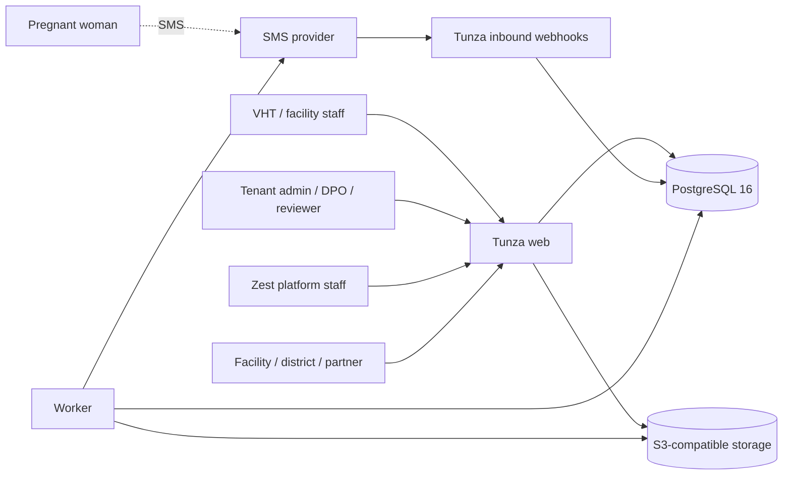

# Tunza architecture

Status: M0 foundations ready for review. This document is a living design and is updated every milestone.

## 1. Purpose and constraints

Tunza is an SMS companion for pregnant women plus a facility and community-health-worker
management platform, aligned to the WHO and Uganda MOH 8-contact antenatal care schedule. It
is built for three deployment models: Zest-hosted multi-tenant (first release), dedicated
single-tenant and customer-hosted containers.

Hard constraints:

- Pregnancy data is special personal data. Security and governance are legal and commercial
  requirements, not features.
- No real patient data is used in development, tests, demos or screenshots.
- The platform notifies people; it does not guarantee action.
- No certification is claimed. The design is built to be ready for audit.
- The platform refuses live messaging for a tenant while any go-live gate is open.

## 2. Context

## 3. Containers

| Container | Responsibility | Scaling |
| --- | --- | --- |
| edge (nginx or Caddy) | TLS, headers, rate limits, optional WAF rules | horizontal |
| web (Flask 3 + gunicorn) | UI routes, role APIs, webhook endpoints, OpenAPI | N replicas, stateless |
| worker | planner, outbox sender, retention, reports, webhooks, escalation timers | one or more leased workers |
| PostgreSQL 16 | transactional store, constraints, RLS, audit log | primary, optional replica |
| PgBouncer | connection pooling | per database |
| object storage | consent images, exports, backups | provider-managed |
| Redis (optional) | rate-limit counters and short caches | optional |
| observability | logs, metrics, traces, alert rules, dashboards | shared platform |

Web and worker run from the same image. The worker is not a separate codebase.

## 4. Modules and boundaries

Each package owns its tables. Modules may call each other only through a service interface,
never by reading another module's tables.

| Module | Owns |
| --- | --- |
| `identity` | users, invitations, sessions, factors, authentication events |
| `tenancy` | organisations, tenant settings, tenant keys, lifecycle, go-live gates |
| `directory` | districts, parishes, facilities |
| `patients` | pregnancy records, guardians, EDD, status changes |
| `consent` | SMS, VHT follow-up and facility-sharing consent |
| `content` | templates, template versions, keywords, approvals, sign-offs |
| `protocols` | versioned care schedules and ANC contacts |
| `scheduling` | message plans, appointments, planner runs |
| `messaging` | outbox, sent log, delivery reports, provider configs, costs |
| `inbound` | webhook validation, conversation state, keyword matching |
| `alerts` | danger-sign escalation, timers, SLA tracking |
| `care` | attendance and referrals |
| `reporting` | facility, district and programme aggregates, exports |
| `integrations` | API keys, outbound webhooks, DHIS2/FHIR adapters |
| `admin` | tenant configuration, account requests, delivery oversight |
| `audit` | append-only hash-chained log and off-box shipping |
| `platform` | metering, feature flags, heartbeats, operational tooling |

## 5. Tenancy and data isolation

- `organisations` is the tenant root. Every business table has `org_id NOT NULL`.
- PostgreSQL RLS is enabled on tenant-scoped tables. Tenant context is set per transaction
  with `set_config('app.org_id', ..., true)`.
- The runtime database role has no `BYPASSRLS`. Migrations run under a separate role.
- RLS is defence in depth. Application permission and SQL scope checks remain mandatory.
- Out-of-scope records return 404 and are audited.
- Per-tenant settings include branding, languages, protocol version, alert SLAs, quiet hours,
  retention, sender IDs, encrypted provider credentials and quotas.
- Per-tenant encryption keys use envelope encryption. Tenant offboarding can crypto-shred
  after the retention period.
- Support access is time-limited, tenant-approved, diagnostics-only and audited. There is no
  impersonation.

## 6. Identity and authorisation

- Individual accounts only. No self-registration. Invitations are approved, single-use,
  hashed, 72-hour tokens and are never logged.
- Users set their own password: 12+ characters, common-password check, Argon2id.
- Identical error for unknown user and wrong password. Five failures lock the account for 15
  minutes and notify the owner. Rate limits by account and IP.
- Second factor is mandatory for every role except `partner_viewer`. SMS is the baseline;
  TOTP and WebAuthn are supported. The console OTP path is impossible in production.
- OIDC SSO is in the first release. It maps verified identities to pre-existing accounts and
  roles and never auto-provisions privileged authority.
- Server-side sessions hold a random ID only. Cookie attributes are HttpOnly, Secure and
  SameSite=Lax. CSRF token on every state-changing request. Idle timeout 15 minutes for
  privileged roles and 30 for the rest; absolute limit 12 hours.
- Permission strings live in one `permissions.py` and are not editable from the UI.
  `@require_permission('x:y')` guards every route and fails closed. A route-map test fails if a
  route lacks it.
- Scope is enforced in SQL. A VHT sees own women; facility staff see women whose home facility
  matches and who consented to facility sharing; partner views are aggregates with any cell
  under 5 suppressed.

## 7. Clinical engine

- Care protocols are versioned, reviewer-approved data. The default is the Uganda MOH
  8-contact model at up to 12, 20, 26, 30, 34, 36, 38 and 40 weeks.
- `EDD = LMP + 280 days`. Gestational week is `floor((today - LMP) / 7)`. An ultrasound EDD
  override stores `edd_source`. Future LMP is rejected; beyond 42 weeks warns. Timezone is
  `Africa/Kampala`. Date logic is property-tested.
- Message text comes only from approved, versioned templates. It is never generated at send
  time. Development seeds are marked `DRAFT - NOT CLINICALLY APPROVED` and can never be
  queued.
- A timed planner turns `message_plan` into `outbox` rows with a unique constraint on
  `(patient, template)`. Running it twice is harmless.
- Eligibility is checked at queue time and again at send time: active, SMS consent held and
  not withdrawn, template approved, language set and outside quiet hours (no non-emergency
  sends from 9 pm to 6 am).
- The worker leases rows with `FOR UPDATE SKIP LOCKED`, rechecks consent, sends, stores the
  provider message ID and writes `sent_log`. A crash cannot double-send. Retries back off at
  1, 5, 15 and 60 minutes, five attempts.
- Segment counting: GSM-7 gives 160 characters (153 per part when joined); anything else
  uses UCS-2 with 70 (67 per part). The reviewer sees a live segment count and approval is
  blocked above a configurable maximum.

## 8. Inbound and alerts

Inbound messages are validated, normalised and matched in this order: STOP, danger sign,
START, HELP, LANG, appointment reply, fallback. STOP opts out immediately, cancels pending
sends and notifies the VHT. Danger categories are bleeding, severe headache or blurred vision,
severe abdominal pain, reduced fetal movement, fever, swelling, convulsions and waters
breaking. When unsure, escalate.

The default alert chain, configurable per tenant and agreed in writing, is:

| Time | Action |
| --- | --- |
| T+0 | notify the VHT by SMS and dashboard |
| T+30 min | notify the facility on call and the supervisor |
| T+60 min | show an SLA breach to the tenant admin and send an SMS |

Shared phones never reveal pregnancy information to an unverified replier. Changed numbers are
handled through a re-verification flow.

## 9. Front end

Vanilla HTML, CSS and JavaScript with no framework and no production build step. ES modules,
`tz-` Web Components, native `<dialog>` and popover, CSS custom properties, cascade layers,
container queries, `:has()` and View Transitions as progressive enhancement. `Intl` for dates,
numbers and plurals. JSON catalogues for English and Luganda, with Kiswahili ready.

No runtime CDN; all assets are self-hosted. The service worker caches static assets only, never
API responses or personal data. JSDoc types are checked with `tsc --checkJs` at dev time.
Budgets: at most 100 KB gzipped JavaScript per page, LCP under 2.5 s on a mid-range Android
over slow 4G, CLS under 0.1. WCAG 2.2 AA, keyboard operable, 44 px touch targets, status shown
by icon plus text plus colour, works at 360 px and 200 percent zoom.

## 10. Key data flows

**Enrolment.** A VHT or facility staff member registers a woman through a gated role route.
The server checks permission and scope, validates age and guardian rules, encrypts names,
phones and guardian details, stores the HMAC phone hash, records the three consent scopes and
writes an audit entry.

**Scheduled send.** The planner reads the active protocol and message plan, checks
eligibility, and inserts idempotent outbox rows. The worker leases a row, rechecks consent,
renders the approved template, counts segments, calls the tenant's gateway with failover,
stores the provider ID and sent log, and records cost.

**Danger sign.** An inbound webhook is validated, matched against danger keywords in the
configured languages, and converted into an alert. Escalation timers notify the VHT, then the
facility and supervisor, then the tenant admin. Every step is audited.

**Audit.** Every login, failure, factor event, lockout, patient read and write, phone reveal,
role change, template approval, configuration change, export, go-live gate change and
permission denial produces an append-only, hash-chained audit row that is shipped off-box.

## 11. Operations

- Environments: development, staging (production-like, synthetic data only) and production.
- Docker Compose for a single node with a documented scale-out path. Terraform or Ansible for
  provisioning. Helm only when a buyer needs Kubernetes.
- CI: lint, type check, tests on PostgreSQL, dependency and secret scans and migration checks.
  Image build, scan and signing land in M9/M10. Deploy only from a tagged commit with manual
  approval for production.
- Zero-downtime deploys use expand-and-contract migrations, rolling or blue-green releases,
  feature flags and a tested rollback.
- Observability includes structured logs without personal data, metrics, traces, dashboards,
  SLOs and alert rules. Key metrics: outbox depth, oldest unsent message, delivery rate, open
  alerts, oldest unacknowledged alert, provider balance and cost per tenant.
- Dead-man's switch: scheduler and worker write heartbeats; silence for two intervals pages
  on-call. An external monitor checks `/readyz`.
- Backups: daily full plus continuous WAL archiving for point-in-time recovery, off-site and
  encrypted. Monthly restore drill. RPO 15 minutes, RTO 4 hours.

## 12. Capacity targets

Assumptions to confirm with a buyer: 250,000 active women and 2 million SMS a month per large
tenant; p95 API latency under 300 ms; planner run for 250,000 women under 5 minutes; 99.9
percent monthly availability; RPO 15 minutes; RTO 4 hours. These are proven with load tests in
M11.

## 13. Recorded decisions

See `docs/adr/` and `DECISIONS.md`. The first-release decisions are: modular monolith
(0001), RLS tenancy (0002), backend stack (0003), identity with OIDC SSO (0004), SMS gateway
interface (0005), vanilla front end (0006), hosted multi-tenant first (0007), field encryption
(0008), metering by active women and segments (0009), VHT and facility enrolment (0010) and
OIDC-first integration scope (0011).

## 14. Milestone status

| Milestone | Status |
| --- | --- |
| M0 Foundations | ready for review |
| M1 Tenancy and identity | not started |
| M2 Authorisation | not started |
| M3 Directory, patients and consent | not started |
| M4 Content and protocols | not started |
| M5 Scheduling and delivery | not started |
| M6 Inbound and alerts | not started |
| M7 Role experiences | not started |
| M8 Reporting and integrations | not started |
| M9 Observability and DevOps | not started |
| M10 Security hardening | not started |
| M11 Performance and recovery | not started |
| M12 Sell-ready pack | not started |
